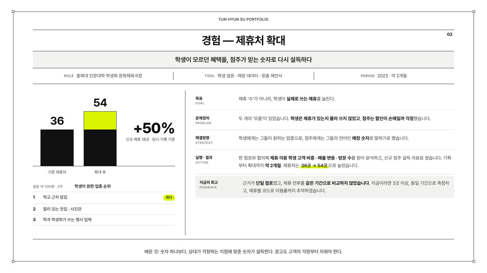
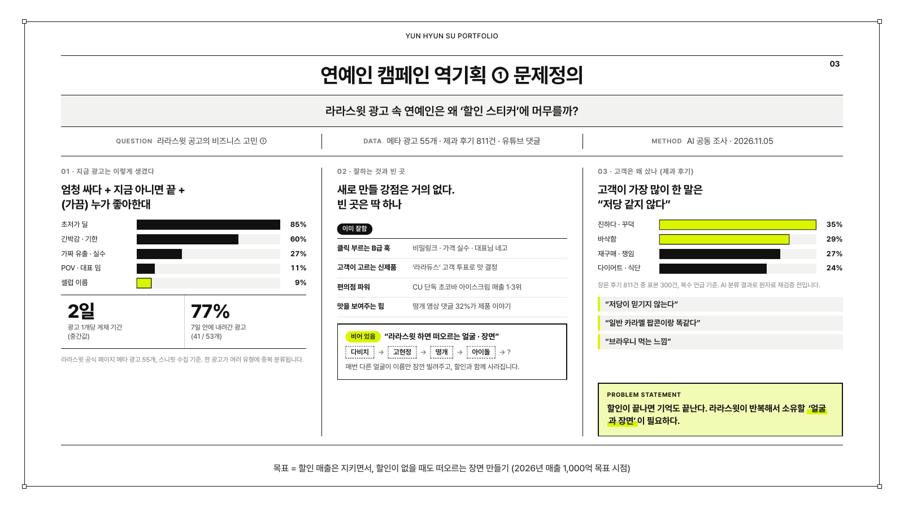
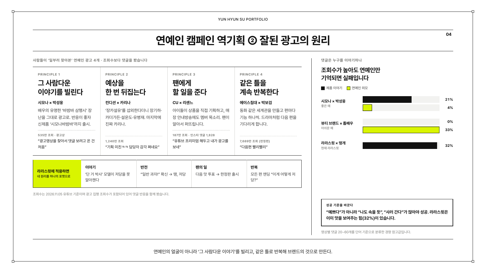
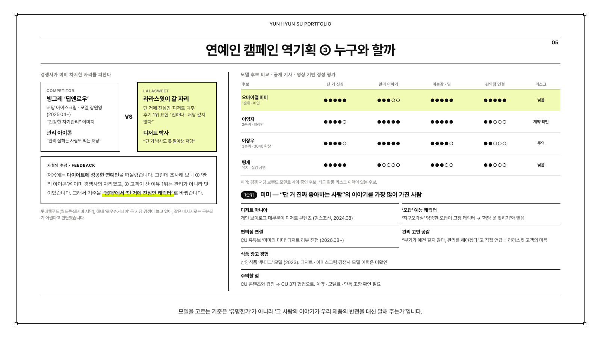
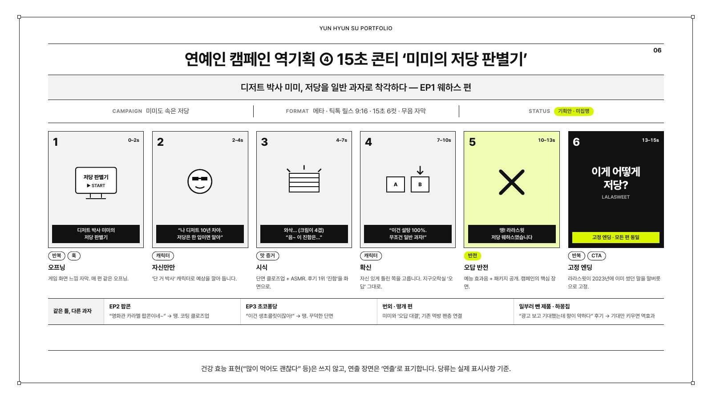
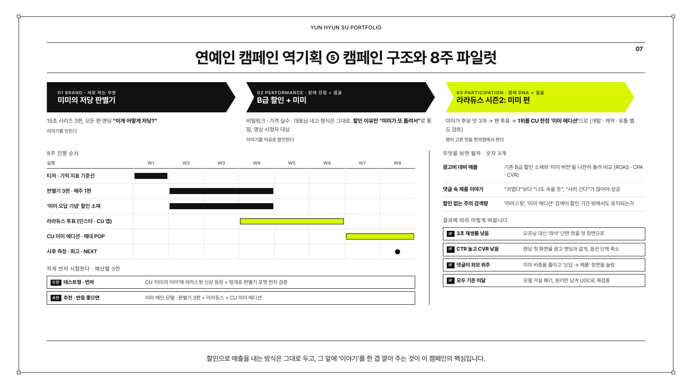

# 🍦 라라스윗 마케팅 포트폴리오

### 고객의 목소리와 숫자로 설득하는 마케터, 윤현수

`라라스윗 마케팅 인턴(채용전환형) 지원` · `2026.11` · `기획안 · 미집행`

---

## 📌 한 줄 요약

> **"미미도 속은 저당"** — 할인으로만 기억되는 라라스윗 광고에 **얼굴과 이야기**를 더하는 연예인 캠페인 역기획

1:1로 설득하던 영업의 언어를, 1:N으로 설득하는 마케팅의 언어로 옮기고 있습니다.

 

## 🗂 목차

| No. | 내용 | 키워드 |
|:---:|---|---|
| 01 | [경험 — 제휴처 36 → 54곳](#01-경험--제휴처-36--54곳) | 설문 · 현장 데이터 · 설득 |
| 02 | [연예인 캠페인 역기획 ① 문제정의](#02-문제정의--할인이-끝나면-기억도-끝난다) | 광고 55개 분석 · 후기 811건 |
| 03 | [② 잘된 광고의 원리](#03-잘된-광고의-원리) | 이야기 · 반전 · 팬 · 반복 |
| 04 | [③ 누구와 할까](#04-누구와-할까) | 경쟁사 포지션 · 모델 비교 |
| 05 | [④ 15초 콘티](#05-15초-콘티--미미의-저당-판별기) | 릴스 9:16 · 6컷 |
| 06 | [⑤ 캠페인 구조와 8주 파일럿](#06-캠페인-구조와-8주-파일럿) | KPI 3개 · IF 시나리오 |

모든 장은 **목표 → 문제정의 → 해결방향 → 실행·결과 → 피드백·NEXT** 순서로 읽힙니다.

 

## 01. 경험 — 제휴처 36 → 54곳

**학생이 모르던 혜택을, 점주가 믿는 숫자로 다시 설득하다**

| 구분 | 내용 |
|---|---|
| 🎯 목표 | 제휴 '수'가 아니라, 학생이 **실제로 쓰는 제휴**를 늘린다 |
| ❓ 문제 | 학생은 제휴를 몰라서 안 쓰고, 점주는 할인이 손해일까 걱정했다 |
| 💡 해결 | 학생에겐 원하는 업종으로, 점주에겐 **매장 숫자**로 말한다 |
| 📈 결과 | 설문 100명 · 2주 → 매장 데이터 분석 → 제휴처 **36곳 → 54곳 (+50%)** |
| 🔁 회고 | 단일 점포 근거였다. 지금이라면 3곳 이상, 동일 기간, 제휴 코드로 측정하겠다 |

 

## 02. 문제정의 — 할인이 끝나면 기억도 끝난다

- 라라스윗 메타 광고 55개 중 **85%가 초저가 딜**, 셀럽 활용은 9%
- 광고 1개 게재 기간 중간값 **2일**, 77%가 7일 안에 내려감
- 고객이 가장 많이 한 말은 **"저당 같지 않다"** (진하다·꾸덕 35%)

> **Problem** — 라라스윗이 반복해서 소유할 **'얼굴과 장면'**이 필요하다

 

## 03. 잘된 광고의 원리

조회수보다 **댓글**을 보고 '일부러 찾아본' 연예인 광고 4개를 분석했습니다.

| 원리 | 사례 | 라라스윗 적용 |
|---|---|---|
| 그 사람다운 이야기를 빌린다 | 시모나 × 박성웅 | '단 거 박사'가 저당을 못 알아챈다 |
| 예상을 한 번 뒤집는다 | 컨디션 × 카리나 | "일반 과자!" 확신 → 땡, 저당 |
| 팬에게 할 일을 준다 | CU × 리센느 | 다음 맛 투표 → 한정판 출시 |
| 같은 틀을 계속 반복한다 | 에이스침대 × 박보검 | 모든 편 엔딩 "이게 어떻게 저당?" |

 

## 04. 누구와 할까

경쟁사가 차지한 **'관리 아이콘'** 자리를 피하고, **'단 거에 진심인 디저트 덕후'** 자리로 갑니다.
처음엔 다이어트에 성공한 연예인을 떠올렸지만, 조사 후 기준을 '몸매'에서 '단 거에 진심인 캐릭터'로 바꿨습니다.

 

## 05. 15초 콘티 — '미미의 저당 판별기'

`오프닝` → `자신만만` → `시식` → `확신` → **`오답 반전`** → `고정 엔딩 "이게 어떻게 저당?"`

 

## 06. 캠페인 구조와 8주 파일럿

| 무엇을 볼까 | 기준 |
|---|---|
| 광고비 대비 매출 | 기존 B급 할인 소재 vs '미미 버전' (ROAS · CPA · CVR) |
| 댓글 속 제품 이야기 | "귀엽다"보다 "나도 속을 듯", "사러 간다"가 많아야 성공 |
| 할인 없는 주의 검색량 | 할인 기간 밖에서도 검색이 유지되는가 |

 

---

## 🛠 작업 방식

- **리서치:** 메타 광고 라이브러리, 제품 후기, 유튜브 댓글을 AI와 함께 수집·분류
- **도구:** Claude (AI 리서치 · 바이브코딩), Figma, HTML → PDF
- **정직하게 표시한 것:** 캠페인은 집행하지 않은 기획안입니다. 제휴 숫자는 당시 기록 기준이며, 후기 분류는 AI 결과로 원자료 재검증 전입니다.

 

## 📎 파일

| 파일 | 설명 |
|---|---|
| `images/` | 포트폴리오 페이지 미리보기 (전체 PDF는 지원서에 첨부) |

 

**"이번 주에는 무엇을 테스트할까요?"**

윤현수 · Chungbuk Nat'l Univ. · Ex-Army Officer

